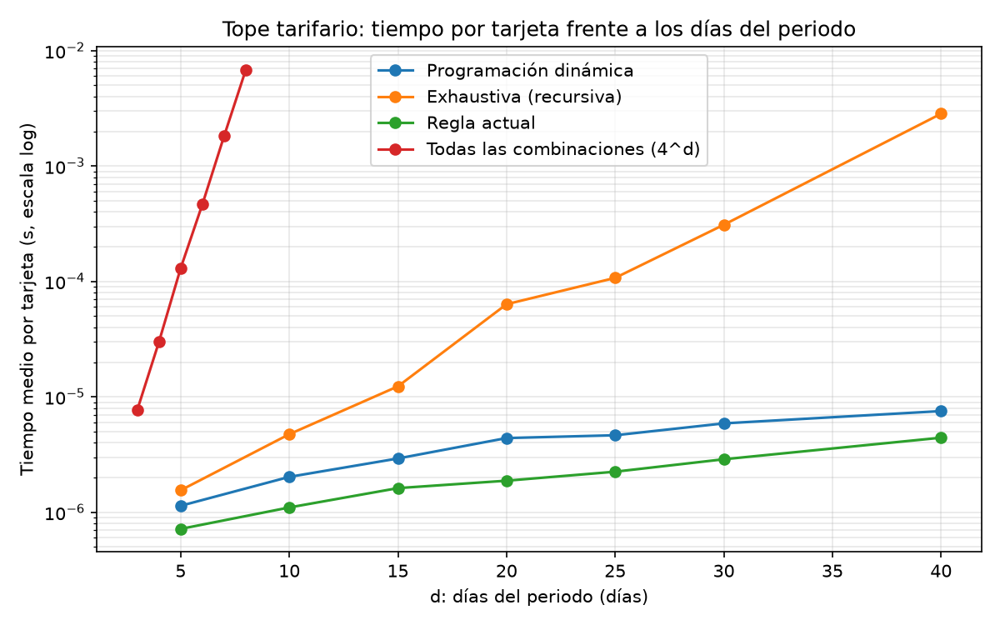

# Rediseño del proceso nocturno de recaudo del SITVM

**Análisis de algoritmos · Proyecto final · Grupo 7 · Caso 1 — Recaudo del transporte**

| Integrante |
| --- |
| Heyner Mena Campaña |
| Juan Andrés Ramírez Castañeda |
| Camilo Ospina Hernández |
| Juliana Arenas Arias |

**Estado:** entrega parcial (Laboratorio 4, 18 de noviembre de 2026): operación 4, liquidación del tope tarifario. El resto se completa para el 23 de noviembre de 2026.

---

## 1. Análisis del problema

### 1.1 Descripción del problema computacional

Pendiente para la entrega del 23 de noviembre.

### 1.2 Operación 4 — Liquidación del tope tarifario: entradas, salida y restricciones

Para resolver el problema del tope tarifario se recibe como entrada una lista llamada viajes_por_dia. Cada posición de la lista representa un día del mes y el valor guardado indica la cantidad de viajes que realizó el usuario durante ese día. Para el caso real se trabaja con meses de entre 28 y 31 días, y todos los costos se manejan en pesos colombianos. Por ejemplo, una lista como [3, 0, 2, 1] representa cuatro días, donde el primer día se hicieron 3 viajes, el segundo ninguno, el tercero 2 y el cuarto 1.

A partir de esta información, el algoritmo debe calcular cuál es el menor valor que el usuario debería pagar, teniendo en cuenta las diferentes opciones disponibles: pagar los viajes de manera individual, utilizar un pase diario, un pase semanal o un pase mensual. La idea es no escoger simplemente la opción que parece más barata en cada día por separado, sino encontrar la combinación que dé el menor costo total.

Para realizar el cálculo también se tuvieron en cuenta algunas restricciones definidas para el problema. Cada mes se analiza de manera independiente, por lo que no se tienen en cuenta pases comprados en meses anteriores. Además, un pase puede cubrir días que queden por fuera del final del mes; en este caso simplemente se utiliza para los días restantes y el tiempo que sobre no genera ninguna devolución.

Otra restricción importante es que el resultado debe ser exacto. Si al usuario se le cobró un valor mayor al mínimo calculado, se debe devolver exactamente la diferencia entre ambos valores. De esta forma no se devuelve ni menos dinero al usuario ni más dinero del que realmente corresponde.

### 1.3 Operaciones críticas del proceso

Pendiente para la entrega del 23 de noviembre.

### 1.4 Costo energético del proceso actual (línea base)

Pendiente para la entrega del 23 de noviembre.

### 1.5 Supuestos

Para desarrollar esta parte del proyecto trabajamos con las tarifas del perfil general, ya que son las que aparecen en el caso de estudio. Los usuarios con tarifas diferenciales manejan la misma estructura de pases, aunque sus precios sean diferentes.

También acordamos analizar cada mes por separado, teniendo en cuenta que puede tener entre 28 y 31 días. Un detalle importante es que el pase mensual cubre 30 días consecutivos y no necesariamente un mes calendario completo. Por eso, en un mes de 31 días, el último día puede necesitar un cobro adicional si el pase se compra desde el primer día. Sin embargo, la solución óptima también puede considerar comprarlo más adelante. Si un pase termina después del cierre del mes, los días que sobren no generan ninguna devolución.

Para representar la regla que utiliza actualmente el sistema, decidimos trabajar con semanas fijas. Primero calculamos cuánto costaría cada día, utilizando la opción más económica entre los pasajes sencillos y el pase diario. Después agrupamos esos valores en bloques de siete días y comparamos cada bloque con el precio del pase semanal. Finalmente revisamos la opción del pase mensual.

Esta interpretación nos permite tener una versión de referencia para comparar con la programación dinámica. Es importante aclarar que la división en semanas fijas fue un supuesto adoptado por el equipo, porque el enunciado no explica todos los detalles de implementación de la regla actual.

## 2. Diseño de la solución

### 2.1 Estructuras de datos seleccionadas

Pendiente para la entrega del 23 de noviembre.

### 2.2 Operación 4 — Por qué el problema admite programación dinámica

Numeramos los días del 1 al `d` y llamamos `C(t)` al costo mínimo de cubrir todos los viajes que hay desde el día `t` hasta el final del mes. La respuesta del problema es `C(1)`.

**Subestructura óptima.** Tomemos el primer día `t` que todavía tiene viajes sin cubrir. En una solución óptima, ese día se resuelve de una de tres maneras: se paga solo (pasajes sencillos o pase diario, el más barato), se compra un pase semanal que arranca ese día, o se compra un pase mensual que arranca ese día. Que el pase empiece justo en `t` no pierde generalidad: si en una solución el pase que cubre `t` empezara antes, correrlo hasta `t` cubre al menos los mismos días con viaje que todavía quedaban por cubrir y no cuesta más.

Después de tomar esa decisión, lo que falta es el mismo problema sobre los días que el pase no alcanzó a cubrir: el pago de un solo día deja el problema en `t + 1`, el pase semanal en `t + 7` y el mensual en `t + 30` (o en el fin del mes, si el pase se pasa). Si la parte que queda no fuera óptima, la cambiaríamos por una más barata y el total bajaría, lo cual contradice que la solución fuera óptima. Por eso el costo óptimo de `t` se arma con los costos óptimos de días posteriores.

**Subproblemas que se repiten.** El costo `C(t)` solo depende del día `t` y no de cómo se llegó a él. Pero hay muchas formas de llegar al mismo día. Por ejemplo, en un mes de 30 días con viajes todos los días, al día 16 se llega con dos semanales y un pago del día 15, o con un pago del día 1 y dos semanales después, o con un semanal, un pago y otro semanal; en todos esos casos lo que falta por cubrir desde el día 16 es exactamente el mismo problema. La solución exhaustiva vuelve a resolverlo una vez por cada camino. En total solo existen `d + 1` subproblemas distintos (uno por día y el caso base), así que basta calcular cada uno una vez y guardarlo en una tabla.

### 2.3 Operación 4 — Ejemplo resuelto a mano

Usamos un mes corto de 8 días con viajes `[3, 3, 1, 0, 3, 3, 2, 1]`, el mismo que se prueba en [`pruebas.py`](src/tope_tarifario/pruebas.py). Para un día solo, `p(v)` es el menor valor entre `3.900·v` y el pase diario de `9.500`. Los valores de la tabla se llenan del día 8 al día 1, y `C(9) = 0` es el caso base. El pase mensual no aparece en las columnas porque en todos los días vale `135.000 + C(9) = 135.000`, que nunca gana.

| Día `t` | Viajes | Pagar el día: `p(v) + C(t+1)` | Semanal: `36.000 + C(min(t+7, 9))` | `C(t)` | Decisión |
| --- | --- | --- | --- | --- | --- |
| 8 | 1 | 3.900 + 0 = 3.900 | 36.000 + 0 = 36.000 | **3.900** | pagar el día |
| 7 | 2 | 7.800 + 3.900 = 11.700 | 36.000 + 0 = 36.000 | **11.700** | pagar el día |
| 6 | 3 | 9.500 + 11.700 = 21.200 | 36.000 + 0 = 36.000 | **21.200** | pagar el día |
| 5 | 3 | 9.500 + 21.200 = 30.700 | 36.000 + 0 = 36.000 | **30.700** | pagar el día |
| 4 | 0 | no hay viajes | no hay viajes | **30.700** | hereda `C(5)` |
| 3 | 1 | 3.900 + 30.700 = 34.600 | 36.000 + 0 = 36.000 | **34.600** | pagar el día |
| 2 | 3 | 9.500 + 34.600 = 44.100 | 36.000 + 0 = 36.000 | **36.000** | semanal |
| 1 | 3 | 9.500 + 36.000 = 45.500 | 36.000 + `C(8)` = 36.000 + 3.900 = 39.900 | **39.900** | semanal |

**Reconstrucción de las compras.** Partimos del día 1: la mejor opción es el semanal (39.900 frente a 45.500), que cubre los días 1 a 7 y nos lleva al día 8. En el día 8 conviene pagar el pasaje sencillo (3.900) y ahí termina el mes. Las compras son un pase semanal el día 1 y un pasaje el día 8: `36.000 + 3.900 = 39.900`. Este valor es el que verifican las pruebas con la programación dinámica y con la solución exhaustiva. La regla actual también cobra 39.900 en esta instancia, así que el ejemplo sirve para entender el método pero no para distinguirlo de la regla; para eso está el contraejemplo del apartado 5.1.

### 2.4 Operación 4 — Recurrencia

Sea `v_t` el número de viajes del día `t`, y `p(v) = min(3.900·v, 9.500)` lo más barato para pagar un día solo. Con los precios de [`tarifas.py`](src/tope_tarifario/tarifas.py), la recurrencia es:

```
C(t) = 0                                   si t > d

C(t) = C(t + 1)                            si 1 ≤ t ≤ d y v_t = 0

C(t) = min( p(v_t) + C(t + 1),
            36.000 + C(min(t + 7,  d + 1)),
            135.000 + C(min(t + 30, d + 1)) )   si 1 ≤ t ≤ d y v_t > 0
```

- **`C(t)`** es el costo mínimo de cubrir los viajes de los días `t` a `d`; la respuesta es `C(1)`.
- **`p(v_t) + C(t + 1)`** es la opción de pagar solo el día `t` y resolver lo que sigue desde el día siguiente.
- **`36.000 + C(min(t + 7, d + 1))`** es comprar un pase semanal ese día: cubre 7 días y se sigue desde `t + 7`. El `min` con `d + 1` evita salirse de la tabla cuando el pase sobrepasa el fin del mes; lo que sobra no se reembolsa (decisión 1 del equipo).
- **`135.000 + C(min(t + 30, d + 1))`** es lo mismo con el pase mensual de 30 días. En un mes de 31 días, un mensual comprado el día 1 deja el día 31 para `C(31)`, que se resuelve con las otras opciones.
- **Un día sin viajes** no necesita ninguna compra, por eso hereda el valor del día siguiente. Los pases sí pueden arrancar en un día con viajes que siga a uno vacío, porque `C(t)` ya los considera al llegar a ese día.
- **Caso base:** `C(d + 1) = 0`, no queda nada por cubrir. Todos los índices mayores a `d` valen 0 y por eso el `min(…, d + 1)` es suficiente.

**Orden de llenado.** `C(t)` solo consulta `C(t + 1)`, `C(t + 7)` y `C(t + 30)`, es decir, posiciones mayores. Por eso la tabla se llena de `t = d` hasta `t = 1`, y cuando se calcula una celda todas las que necesita ya están listas. En [`estrategia.py`](src/tope_tarifario/estrategia.py) la tabla tiene `d + 2` posiciones para poder usar los días con la misma numeración de la recurrencia (`viajes_por_dia[t - 1]` es el día `t`).

### 2.5 Segunda operación

Pendiente para la entrega del 23 de noviembre.

## 3. Implementación

### 3.1 Operación 4 — Código

- [Estrategia (programación dinámica)](src/tope_tarifario/estrategia.py)
- [Solución exhaustiva](src/tope_tarifario/exhaustivo.py)
- [Regla actual](src/tope_tarifario/regla_actual.py)
- [Pruebas](src/tope_tarifario/pruebas.py)
- [Tarifas](src/tope_tarifario/tarifas.py)

### 3.2 Tecnologías y herramientas

Todo el código está escrito en Python 3.13. La única biblioteca externa es matplotlib 3.11.2, que usamos solo para dibujar las gráficas; la programación dinámica, la búsqueda exhaustiva y la regla actual las implementamos nosotros, sin bibliotecas de optimización. Para medir el tiempo usamos `time.perf_counter()` y para los datos sintéticos el módulo `random` con semilla fija.

Trabajamos con un entorno virtual (`venv`) y dejamos la dependencia en `requirements.txt`, así cualquiera puede instalar exactamente lo mismo. El control de versiones lo llevamos en Git y GitHub, donde cada integrante sube sus cambios con su propia cuenta.

### 3.3 Decisiones de implementación

- **Las tarifas están en un solo archivo.** `tarifas.py` tiene los precios, la duración de los pases y la función `costo_del_dia`, para calcular más barato el pagar un solo día. Las tres soluciones se usan, así que todas parten de la misma regla para un día y la comparación es justa.
- **Contamos operaciones sin cambiar las firmas pedidas.** Toda solución tiene una versión "contada" (`costo_minimo_contado`, `costo_exhaustivo_contado`, `costo_regla_actual_contado`) que devuelve el costo y el número de opciones que se evaluaron. La función original llama la versión y devuelve solo el costo. No usamos variables globales.
- **Los datos son reproducibles.** `datos.py` genera las tarjetas con una semilla fija (2026 más el número de días), y en cada tamaño las tres soluciones se miden sobre las mismas tarjetas. Cerca del 90 % de los días tienen entre 1 y 4 viajes, porque la guía va pidiendo viajes en todos o casi todos los días.
- **Los días se cuentan del 1 al d**, como en el calendario, y la posición d + 1 es el caso base (no quedan días por pagar). Así el código se lee igual que la recurrencia del informe.

## 4. Evaluación del desempeño

### 4.1 Operación 4 — Complejidad temporal y espacial

Llamamos `d` a los días del periodo y `k` a los días que tienen al menos un viaje (`k ≤ d`). La unidad de operación es la "opción evaluada", la misma de las tres soluciones.

**Programación dinámica ([`estrategia.py`](src/tope_tarifario/estrategia.py)).**

- *Tiempo:* la tabla tiene `d` celdas y cada una se calcula con a lo sumo tres opciones, cada una con un costo constante (una suma y una comparación). Un día con viajes evalúa 3 opciones y un día vacío evalúa 1, así que el contador da `3k + (d − k)`, que está entre `d` y `3d`: **Θ(d)**. Esto vale en el mejor, el peor y el caso promedio, porque el recorrido no depende de los valores de los viajes. Para `N` tarjetas el proceso completo cuesta Θ(N·d).
- *Espacio:* la tabla guarda `d + 2` enteros: **Θ(d)**. Como cada celda solo mira hasta 30 posiciones adelante, bastaría con conservar las últimas 31 y el espacio bajaría a Θ(1), pero mantenemos la tabla completa porque con ella se podría reconstruir qué pases se compraron, como hicimos a mano en el ejemplo del apartado 2.3.

**Solución exhaustiva ([`exhaustivo.py`](src/tope_tarifario/exhaustivo.py)).** No reutiliza subproblemas, así que cada día con viajes se bifurca en tres llamadas (siguiente día, `t + 7` y `t + 30`).

- *Tiempo:* en `costo_exhaustivo` solo se bifurca en los días con viaje, y el árbol de llamadas crece como mínimo según `T(k) ≥ T(k − 1) + T(k − 7)`, lo que da una base aproximada de 1,26 (raíz de `x⁷ = x⁶ + 1`): **exponencial en `k`**. Lo comprobamos con el contador: al sumar dos días con viaje el número de opciones se multiplica por cerca de 1,58, que es 1,26². La variante `costo_combinaciones`, que prueba cuatro decisiones por día aunque sean redundantes, hace 4 llamadas por nivel y recorre `4^d` caminos: **Θ(4^d)**.
- *Espacio:* la pila de recursión llega a `d` llamadas y no se guarda tabla: **Θ(d)**. Es decir, la exhaustiva no ahorra memoria; lo que cambia es el tiempo.

**Regla actual ([`regla_actual.py`](src/tope_tarifario/regla_actual.py)).** Recorre los días una vez para calcular el costo de cada uno y luego recorre los bloques de 7 días, con una cantidad constante de trabajo por bloque. El tiempo es **Θ(d)** y el espacio **Θ(d)** por la lista de costos diarios. Es decir, tiene la misma complejidad que la programación dinámica: la diferencia entre las dos no está en cuánto cuestan sino en que la regla puede cobrar de más.

| Solución | Tiempo | Espacio |
| --- | --- | --- |
| Programación dinámica | Θ(d) | Θ(d) |
| Regla actual | Θ(d) | Θ(d) |
| Exhaustiva recursiva | exponencial en `k` (≈ 1,26^k) | Θ(d) |
| Exhaustiva por combinaciones | Θ(4^d) | Θ(d) |

El contraste de fondo es que la programación dinámica pasa de un número exponencial de caminos a solo `d + 1` subproblemas, porque calcula una sola vez cada `C(t)`. Como los meses tienen a lo sumo 31 días, `d` es acotado y cada tarjeta cuesta un número pequeño de operaciones; la solución exhaustiva sí se vuelve inviable al crecer `k`, que es el caso de las tarjetas que viajan casi todos los días.

### 4.2 Verificación

Para verificar que la solución propuesta encuentre realmente el costo mínimo, se creó el archivo `pruebas.py`, donde se comparan los resultados de la programación dinámica con la solución exhaustiva en diferentes tipos de casos.

Primero se probaron algunos casos límite, como una lista vacía, un solo día con viajes, varios días sin ningún viaje y un periodo corto donde resulta más económico utilizar un pase semanal que pagar cada día por separado. Esto permite comprobar que el algoritmo también funciona correctamente en situaciones sencillas o poco comunes.

También se utilizó el ejemplo que se resolvió manualmente, correspondiente a la lista `[3, 3, 1, 0, 3, 3, 2, 1]`, cuyo costo mínimo esperado es de $39.900. Tanto la estrategia de programación dinámica como la solución exhaustiva deben obtener este mismo valor.

Además, se generan 25 casos aleatorios pequeños utilizando una semilla fija. Para cada uno de estos casos se calcula el resultado con la solución exhaustiva y luego se compara con el obtenido por programación dinámica. Se utilizan tamaños pequeños debido a que la solución exhaustiva aumenta rápidamente su costo a medida que crece la cantidad de días, por lo que en esta parte se usa principalmente como una forma de comprobar que la estrategia optimizada está llegando al mismo resultado mínimo.

También se verifica la restricción principal del negocio relacionada con la devolución. Si al usuario se le cobró un valor mayor al costo mínimo, la devolución debe ser exactamente la diferencia entre ambos valores. Si el cobro ya corresponde al mínimo o es menor, la devolución debe ser cero.

Por último, se incluyen dos contraejemplos. El corto, `[0, 0, 0, 0, 0, 3, 3, 3, 3]`, en el que la regla actual cobra $38.000 y la estrategia propuesta encuentra $36.000. Y el del apartado 5.1: un mes de 30 días con tres viajes diarios del día 4 al día 10, en el que la regla cobra $64.500, el mínimo es $36.000 y la devolución calculada es exactamente $28.500. Con estas pruebas se comprueba que la regla actual no siempre encuentra la opción más económica.

Los casos límite incluyen además un febrero (28 días) y un mes de 31 días con tres viajes diarios. Gracias a ellos encontramos y corregimos un error en la regla actual: solo revisaba el pase mensual en meses de 30 o 31 días, de modo que en febrero cobraba $144.000 en lugar de $135.000.

### 4.3 Operación 4 — Diseño de los experimentos y resultados

- [Generador de datos](src/tope_tarifario/datos.py)
- [Medición](src/tope_tarifario/medicion.py)




**Cómo medimos.** Corrimos [`medicion.py`](src/tope_tarifario/medicion.py) en un portátil con procesador AMD (familia 25), Windows 11 y Python 3.13.3. Las tarjetas salen de [`datos.py`](src/tope_tarifario/datos.py) con semilla fija (2026 más el número de días), así que las tres soluciones se miden sobre las mismas tarjetas. En cada tamaño usamos 20 tarjetas y repetimos la medición 5 veces; el tiempo que reportamos es el promedio por tarjeta. Con `time.perf_counter()` solo se cronometra la llamada a cada solución, no la generación de los datos. Dentro del mismo experimento se verifica que la programación dinámica y la exhaustiva den el mismo costo en todas las tarjetas. Las tablas completas quedaron en [`resultados.md`](graficas/tope_tarifario/resultados.md).

Hicimos tres experimentos:

| Experimento | Soluciones | Tamaños `d` (días) | Para qué |
| --- | --- | --- | --- |
| A | Programación dinámica, exhaustiva recursiva y regla actual | 5, 10, 15, 20, 25, 30 y 40 | Comparar las tres en los mismos ejes, con las parejas 10 → 20 y 20 → 40 |
| B | Programación dinámica y regla actual | De 30 a 7.680, duplicando | Ver la forma de la curva en tamaños grandes, donde la exhaustiva ya no corre |
| C | Exhaustiva por combinaciones (4^d) | 3 a 8 | Mostrar por qué el proceso que explora todas las combinaciones no termina |

**Resultados del experimento A (tiempo medio por tarjeta y opciones evaluadas):**

| `d` | DP: tiempo (s) | DP: operaciones | Exhaustiva: tiempo (s) | Exhaustiva: operaciones | Regla: tiempo (s) | Regla: operaciones |
| --- | --- | --- | --- | --- | --- | --- |
| 5 | 1,14e-06 | 13 | 1,55e-06 | 13 | 7,17e-07 | 14 |
| 10 | 2,02e-06 | 28 | 4,74e-06 | 41 | 1,10e-06 | 26 |
| 15 | 2,92e-06 | 42 | 1,23e-05 | 129 | 1,62e-06 | 38 |
| 20 | 4,39e-06 | 56 | 6,35e-05 | 407 | 1,88e-06 | 48 |
| 25 | 4,65e-06 | 70 | 1,07e-04 | 1.162 | 2,24e-06 | 60 |
| 30 | 5,89e-06 | 84 | 3,10e-04 | 3.482 | 2,88e-06 | 72 |
| 40 | 7,53e-06 | 112 | 2,84e-03 | 30.596 | 4,42e-06 | 94 |

En las gráficas de tiempo y de operaciones el eje vertical está en escala logarítmica: así una curva exponencial se ve como una recta inclinada y una lineal se ve casi plana. La exhaustiva por combinaciones (roja) sube casi vertical, la exhaustiva recursiva (naranja) sube en línea recta, y la programación dinámica (azul) y la regla (verde) apenas crecen. En el experimento B, ya en escala normal, las dos curvas son rectas: el tiempo crece en proporción a los días.

### 4.4 Operación 4 — Lo medido contra lo esperado

Tomamos las parejas en las que el segundo tamaño es el doble del primero y calculamos cuánto se multiplicó cada medida:

| Solución | `d` → `2d` | Factor de tiempo | Factor de operaciones | Esperado por la complejidad |
| --- | --- | --- | --- | --- |
| Programación dinámica | 10 → 20 | 2,17 | 1,98 | 2 (Θ(d)) |
| Programación dinámica | 20 → 40 | 1,71 | 1,99 | 2 |
| Programación dinámica (B) | 960 → 1.920 | 2,09 | 2,01 | 2 |
| Programación dinámica (B) | 3.840 → 7.680 | 1,96 | 2,00 | 2 |
| Regla actual | 10 → 20 | 1,71 | 1,85 | 2 (Θ(d)) |
| Regla actual (B) | 3.840 → 7.680 | 1,88 | 2,00 | 2 |
| Exhaustiva recursiva | 10 → 20 | 13,38 | 9,86 | ≈ 1,26^9 ≈ 8 |
| Exhaustiva recursiva | 20 → 40 | 44,72 | 75,21 | ≈ 1,26^18 ≈ 64 |

**Programación dinámica y regla actual.** Al duplicar `d`, las operaciones se multiplican por 1,98 a 2,01, prácticamente el 2 que predice Θ(d). El tiempo también ronda 2, pero con más variación (de 1,71 a 2,17), sobre todo en los tamaños pequeños: ahí cada tarjeta tarda unos pocos microsegundos y cualquier tarea del sistema operativo pesa en la medición. En los tamaños grandes del experimento B, donde el tiempo ya es de milisegundos, el factor se acerca más a 2 (1,96 a 2,09). La programación dinámica tarda entre 1,6 y 2,6 veces lo que tarda la regla: tienen el mismo orden de crecimiento y solo cambia la constante, porque la DP evalúa el semanal y el mensual en cada día con viajes.

**Exhaustiva recursiva.** El factor no es constante: crece con el tamaño (≈ 10 al pasar de 10 a 20 días y ≈ 75 de 20 a 40), que es la firma de un crecimiento exponencial. Como en nuestros datos cerca del 90 % de los días tienen viajes, al duplicar de 10 a 20 se agregan unos 9 días con viaje y de 20 a 40 unos 18. Con la base de 1,26 por día con viaje del apartado 4.1, lo esperado es ≈ 8 y ≈ 64; medimos 9,86 y 75,21, del mismo orden. La diferencia viene de que los días vacíos y los pases que se salen del mes no siguen exactamente la recurrencia mínima. El factor de tiempo de 20 → 40 (44,72) es menor que el de operaciones porque el tiempo de `d = 20` salió alto por ruido (6,35e-05 s, casi lo mismo que en `d = 25`). Por eso, para comparar con la teoría nos apoyamos en las operaciones, que no tienen ruido.

**Exhaustiva por combinaciones.** Cada día extra multiplica las operaciones casi exactamente por 4 (de 84 a 340, a 1.364, …, a 87.380), como predice Θ(4^d).

### 4.5 Operación 4 — Extrapolación al volumen real y ventana operativa

Para llevar las mediciones al volumen real tomamos el tiempo medio por tarjeta con `d = 30` y lo multiplicamos por las 950.000 tarjetas que se usan al mes. Esto es válido para la programación dinámica y para la regla porque son lineales en `d` (lo vimos en el apartado 4.4) y cada tarjeta se liquida por separado, así que el total crece en proporción al número de tarjetas. Para la exhaustiva recursiva también usamos el tiempo medido con `d = 30`, porque un mes no pasa de 31 días. Para la de combinaciones, que solo pudimos correr hasta `d = 8`, multiplicamos el tiempo medido por combinación por las 4^30 combinaciones de un mes. **Son estimaciones**, no mediciones del volumen real.

| Solución | Tiempo por tarjeta | Tiempo de un cierre de mes | ¿Cabe en la ventana de 4 h? |
| --- | --- | --- | --- |
| Programación dinámica | 5,89 µs | ≈ 5,6 s | Sí |
| Regla actual | 2,88 µs | ≈ 2,7 s | Sí |
| Exhaustiva recursiva | 0,31 ms | ≈ 4,9 min | Sí, para un mes |
| Exhaustiva por combinaciones | ≈ 9 × 10¹⁰ s (≈ 2.900 años) | ≈ 2,4 × 10¹³ h | No: no termina |

La programación dinámica liquida todas las tarjetas en unos segundos, muy lejos del límite de 4 horas. La exploración de todas las combinaciones, que es lo que describe el caso como proceso actual, tardaría unos 2.900 años en una sola tarjeta: por eso hoy no termina y se usa la regla simplificada.

Un hallazgo que no esperábamos: la exhaustiva recursiva, que decide solo qué comprar en el primer día sin pagar, sí cabría en la ventana para un mes (≈ 4,9 minutos). Esto pasa porque el pase mensual corta muchas ramas. Pero su costo es exponencial: al pasar de 20 a 40 días sus operaciones se multiplicaron por 75, así que si el periodo de liquidación fuera más largo o se agregaran productos, dejaría de caber muy rápido. La programación dinámica, en cambio, crece en línea recta.

Si las validaciones crecieran un 30 %, la DP seguiría siendo lineal en el número de tarjetas: con 1.235.000 tarjetas el cierre tardaría unos 7 segundos.

### 4.6 Segunda operación

Pendiente para la entrega del 23 de noviembre.

## 5. Análisis comparativo

### 5.1 Operación 4 — Contraejemplo de la regla actual

Para comprobar si la regla actual siempre encuentra el menor costo, utilizamos un caso de 30 días en el que una tarjeta registra tres viajes diarios desde el día 4 hasta el día 10. Durante los demás días no se realizan viajes.

Al aplicar la regla simplificada, los viajes quedan separados en dos bloques semanales. En el primer bloque, correspondiente a los días 1 al 7, el costo de los viajes es de $38.000, por lo que se utiliza el pase semanal de $36.000. En el segundo bloque, de los días 8 al 14, los tres días con viajes cuestan $28.500. Sumando ambos valores, la regla obtiene un cobro total de $64.500.

El problema es que los viajes se realizan durante siete días consecutivos, aunque estén repartidos entre dos bloques diferentes. Si se compra un pase semanal desde el día 4, se pueden cubrir todos los viajes hasta el día 10 pagando solamente $36.000.

Esto significa que la regla actual cobra $28.500 más que el costo mínimo. El ejemplo demuestra que dividir el mes en semanas fijas puede producir resultados incorrectos, porque no permite aprovechar completamente un pase que comienza a mitad de una semana.

Por esta razón, consideramos necesario utilizar una estrategia que evalúe las distintas fechas en las que se pueden comprar los pases, en lugar de limitarse a los bloques establecidos.

### 5.2 Operación 4 — Condición contraria

Aunque en este problema la programación dinámica es la alternativa más adecuada, también analizamos en qué condiciones podría funcionar una estrategia voraz.

Una estrategia voraz toma la decisión que parece más conveniente en cada momento y continúa sin revisar las decisiones anteriores. Para que funcione correctamente, necesitamos tener la seguridad de que esa elección inmediata no perjudicará el resultado final.

En nuestro caso, esto no se cumple porque un pase semanal puede cubrir viajes de varios días y comenzar en cualquier momento. Una opción que parece económica para un día puede hacer que se desaproveche un pase que habría reducido el costo total.

Una condición que permitiría usar una estrategia voraz más sencilla sería que solamente existieran pasajes individuales y pases diarios. En ese escenario, cada día se podría resolver de manera independiente, escogiendo el menor costo entre ambas opciones, sin que esa decisión afectara los días siguientes.

Por lo tanto, la estrategia voraz sería suficiente si desaparecieran las decisiones que afectan varios días. Mientras existan pases semanales y mensuales que puedan comenzar en distintas fechas y se exija encontrar el costo mínimo exacto, es necesario evaluar las alternativas de forma más completa. Para eso utilizamos programación dinámica.

### 5.3 Operación 4 — Recomendación

Para la liquidación del tope tarifario se recomienda utilizar la solución basada en programación dinámica. La principal razón es que esta estrategia permite encontrar el costo mínimo real teniendo en cuenta todas las alternativas disponibles, sin necesidad de probar todas las combinaciones posibles como ocurre con la solución exhaustiva.

Frente a la regla actual, la programación dinámica tiene la ventaja de que no depende de dividir el mes en bloques fijos para tomar la decisión. Esto es importante porque un pase semanal puede comenzar en cualquier día y cubrir días que pertenezcan a dos bloques diferentes. En esos casos, la regla actual puede terminar cobrando más de lo necesario, como se observa en el contraejemplo utilizado durante las pruebas.

Otra ventaja es que la programación dinámica mantiene un costo de ejecución manejable a medida que aumenta la cantidad de días analizados, mientras que la solución exhaustiva crece demasiado rápido y solamente resulta útil para verificar casos pequeños. Por esta razón, la solución exhaustiva puede servir como apoyo durante las pruebas, pero no sería una opción adecuada para utilizarla en el proceso real.

Como límite de la solución, se debe tener en cuenta que el algoritmo depende de las reglas y productos tarifarios definidos actualmente. Si en el futuro se agregan nuevos tipos de pases, cambian sus duraciones o se modifican las condiciones para utilizarlos, la lógica del algoritmo también tendría que actualizarse para seguir garantizando que se encuentre el costo mínimo correcto.

Por lo tanto, se considera que la programación dinámica es la alternativa más adecuada para esta operación, ya que permite obtener una liquidación exacta y evita que el usuario termine pagando un valor mayor al que realmente le corresponde.

### 5.4 Comparación global y solución seleccionada

Pendiente para la entrega del 23 de noviembre.

## 6. Implicaciones éticas, sociales y ambientales

### 6.1 Consumo energético — Operación 4

La energía se calcula como potencia por tiempo: kWh = kW × h, con el servidor de 500 W (0,5 kW) que informa el cliente y 12 cierres de mes al año. Los tiempos son los extrapolados en el apartado 4.5, así que también son estimaciones.

| Solución | Horas por cierre | kWh por cierre | kWh por año (12 cierres) |
| --- | --- | --- | --- |
| Programación dinámica | 0,0016 | 0,0008 | 0,009 |
| Regla actual | 0,0008 | 0,0004 | 0,005 |
| Exhaustiva recursiva | 0,0817 | 0,0408 | 0,490 |
| Exhaustiva por combinaciones | ≈ 2,4 × 10¹³ | ≈ 1,2 × 10¹³ | No termina |

**Frente a la regla actual**, la programación dinámica gasta un poco más: unos 0,004 kWh más al año, una cantidad despreciable (menos de lo que consume un bombillo LED en una hora). A cambio, devuelve exactamente lo que corresponde a cada usuario. En nuestra muestra sintética de 1.000 tarjetas de 30 días, la regla cobró de más al 1,5 % de las tarjetas, con un máximo de $11.400 en una tarjeta; si esa proporción se repitiera en las 950.000 tarjetas, serían unos $56 millones al mes cobrados de más. Esta cifra depende de cómo generamos los datos, así que solo indica el orden de magnitud.

**Frente al proceso que explora todas las combinaciones**, el ahorro es total: ese proceso no termina, mientras que la programación dinámica cierra el mes en segundos con menos de una milésima de kWh. Frente a la exhaustiva recursiva, la DP ahorra unos 0,48 kWh al año y, sobre todo, no corre el riesgo de crecer de forma exponencial si cambian las condiciones.

### 6.2 Preguntas de impacto del caso

Pendiente para la entrega del 23 de noviembre.

### 6.3 Consecuencias sobre las personas

Pendiente para la entrega del 23 de noviembre.

### 6.4 Marco normativo y buenas prácticas

Pendiente para la entrega del 23 de noviembre.

### 6.5 Sostenibilidad de la decisión (crecimiento del 30 %)

Pendiente para la entrega del 23 de noviembre.

## 7. Conclusiones

Pendiente para la entrega del 23 de noviembre.

---

## Reproducción

Requisitos: Python 3.10 o superior.

```cmd
py -m venv .venv
.venv\Scripts\activate
pip install -r requirements.txt
python src/tope_tarifario/pruebas.py
python src/tope_tarifario/medicion.py
```

En Linux o macOS, el entorno se activa con `source .venv/bin/activate`.

`datos.py` genera las tarjetas sintéticas con semilla fija, de modo que cada ejecución produce los mismos datos. `pruebas.py` verifica que la programación dinámica coincide con la solución exhaustiva y que se cumple la restricción del negocio; si todo está bien, imprime "Todas las pruebas pasaron". `medicion.py` corre los experimentos y guarda en `graficas/tope_tarifario/` las gráficas `tiempo_vs_n.png`, `operaciones_vs_n.png` y `tiempo_dp_periodos_largos.png`, junto con `resultados.md`, que tiene las tablas usadas en este informe.
