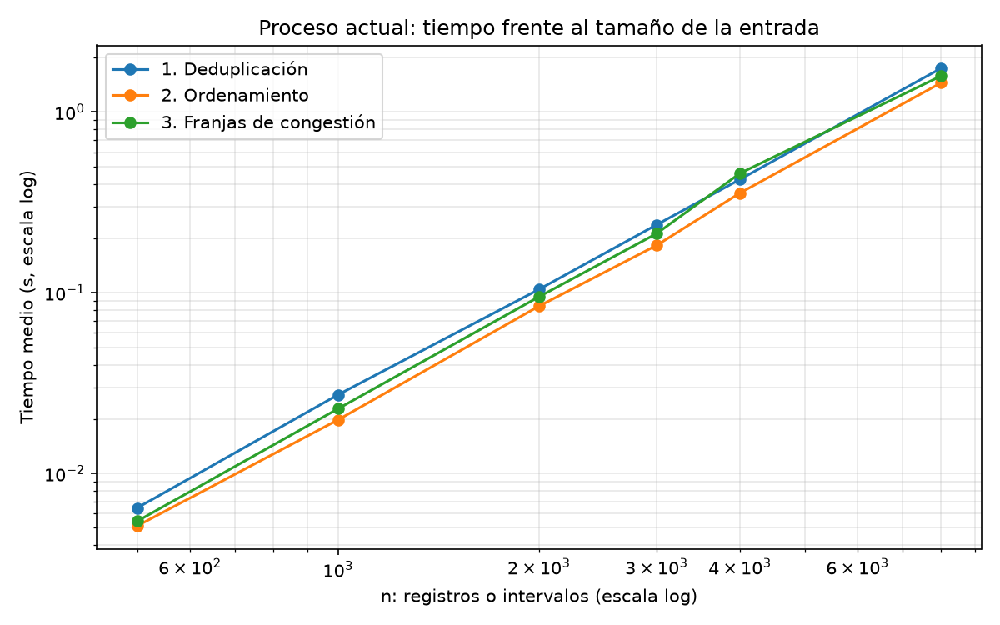
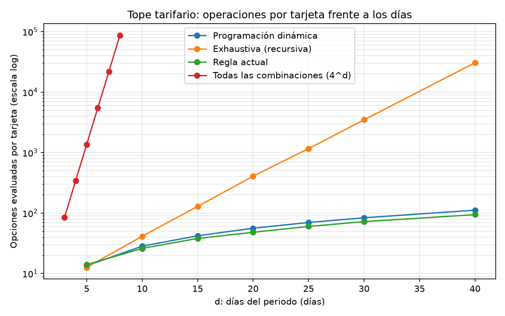
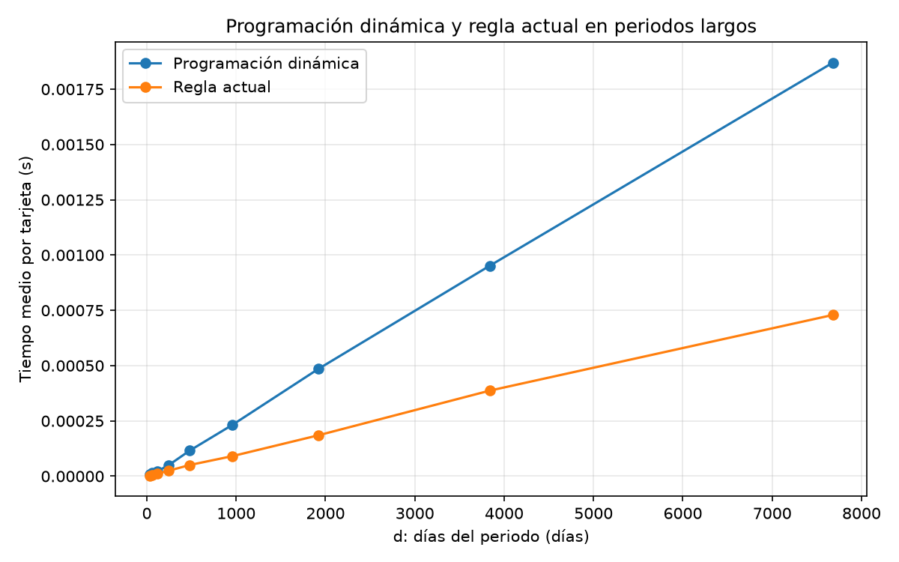
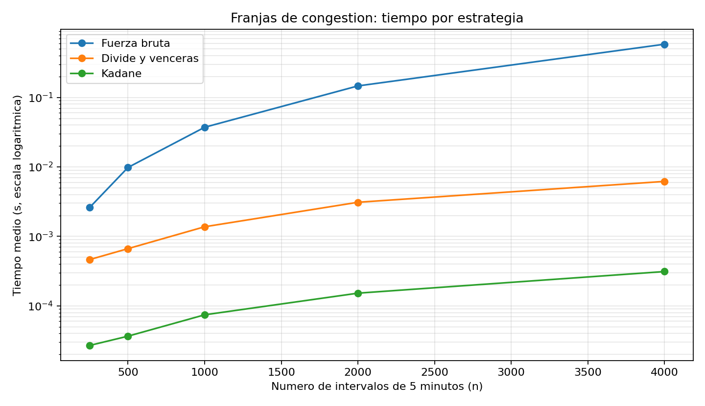
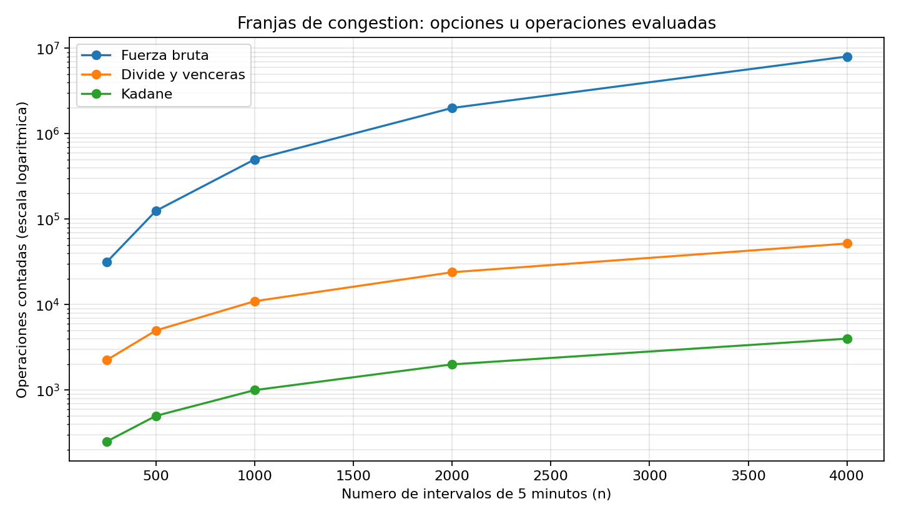
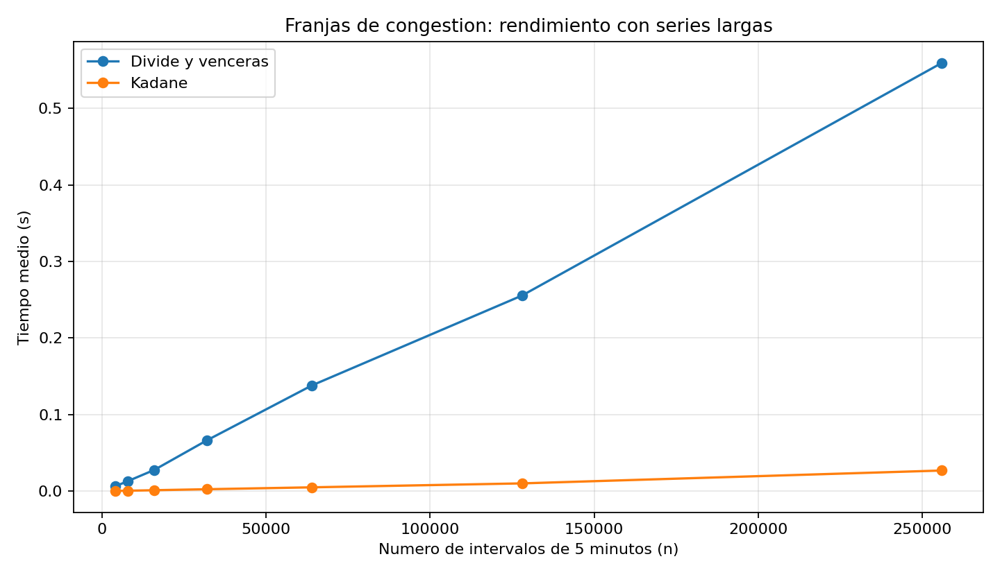

# Rediseño del proceso nocturno de recaudo del SITVM

**Análisis de algoritmos · Proyecto final · Grupo 7 · Caso 1 — Recaudo del transporte**

| Integrante |
| --- |
| Heyner Mena Campaña |
| Juan Andrés Ramírez Castañeda |
| Camilo Ospina Hernández |
| Juliana Arenas Arias |

**Estado:** entrega parcial (Laboratorio 4, 18 de noviembre de 2026): operación 4, liquidación del tope tarifario. El resto se completa para el 23 de noviembre de 2026.

---

## 1. Análisis del problema

### 1.1 Descripción del problema computacional

El SITVM concilia cada noche, en un proceso por lotes sobre un único servidor de 500 W, todas las validaciones del día: unos 1,4 millones de registros que llegan de 2.100 validadores, con entre 4 % y 9 % repetidos porque los buses reenvían lotes completos cuando la descarga se interrumpe. Con esos registros el proceso depura, ordena y liquida, y entrega información a Recaudo, a Atención al Usuario y a Planeación de la Operación.

El problema computacional consiste en que ese proceso dejó de caber en la ventana de 4 horas (00:00 a 04:00). Según el cliente, hoy tarda más de 8 horas, y la causa no es el equipo sino las estrategias algorítmicas: tres de las cuatro operaciones crecen de forma cuadrática con el tamaño de la entrada y la cuarta explora un número exponencial de combinaciones. El trabajo es medir ese costo, proponer estrategias que den exactamente el mismo resultado con menos operaciones y estimar cuánta energía y cuánto tiempo se ahorran en el volumen real.

### 1.2 Operación 4 — Liquidación del tope tarifario: entradas, salida y restricciones

Para resolver el problema del tope tarifario se recibe como entrada una lista llamada viajes_por_dia. Cada posición de la lista representa un día del mes y el valor guardado indica la cantidad de viajes que realizó el usuario durante ese día. Para el caso real se trabaja con meses de entre 28 y 31 días, y todos los costos se manejan en pesos colombianos. Por ejemplo, una lista como [3, 0, 2, 1] representa cuatro días, donde el primer día se hicieron 3 viajes, el segundo ninguno, el tercero 2 y el cuarto 1.

A partir de esta información, el algoritmo debe calcular cuál es el menor valor que el usuario debería pagar, teniendo en cuenta las diferentes opciones disponibles: pagar los viajes de manera individual, utilizar un pase diario, un pase semanal o un pase mensual. La idea es no escoger simplemente la opción que parece más barata en cada día por separado, sino encontrar la combinación que dé el menor costo total.

Para realizar el cálculo también se tuvieron en cuenta algunas restricciones definidas para el problema. Cada mes se analiza de manera independiente, por lo que no se tienen en cuenta pases comprados en meses anteriores. Además, un pase puede cubrir días que queden por fuera del final del mes; en este caso simplemente se utiliza para los días restantes y el tiempo que sobre no genera ninguna devolución.

Otra restricción importante es que el resultado debe ser exacto. Si al usuario se le cobró un valor mayor al mínimo calculado, se debe devolver exactamente la diferencia entre ambos valores. De esta forma no se devuelve ni menos dinero al usuario ni más dinero del que realmente corresponde.

### 1.3 Operaciones críticas del proceso

| # | Operación | Tamaño `n` en el volumen real | Estrategia actual | Orden de crecimiento | ¿Se trabaja en este proyecto? |
| --- | --- | --- | --- | --- | --- |
| 1 | Deduplicación de validaciones | 1.400.000 registros por noche | Compara cada validación con todas las ya aceptadas | Θ(n²) | No (se mide como línea base) |
| 2 | Ordenamiento por tarjeta y hora | ≈ 1.309.000 validaciones únicas por noche | Ordenamiento por inserción | Θ(n²) en el caso promedio | No (se mide como línea base) |
| 3 | Detección de las franjas de congestión | 166.000 intervalos por estación × 80 estaciones | Evalúa todos los tramos posibles de la serie | Θ(n²) | Sí (apartados 2.5 y 4.6) |
| 4 | Liquidación del tope tarifario | 950.000 tarjetas × 28 a 31 días | Explora todas las combinaciones de pases y, si no termina, aplica una regla simplificada | Exponencial (≈ 4^d por tarjeta) | Sí (Laboratorio 4) |

Para comprobar que estas son las operaciones más costosas, reprodujimos en [`proceso_actual.py`](src/linea_base/proceso_actual.py) las estrategias actuales de las operaciones 1, 2 y 3 y las medimos con [`medicion.py`](src/linea_base/medicion.py) en tamaños de 500 a 8.000. Al duplicar `n`, las operaciones de las tres se multiplicaron por 4,00 a 4,04 y el tiempo por 3,45 a 4,26: es el factor 4 que corresponde a un crecimiento cuadrático. La operación 4 se midió en el Laboratorio 4 (apartados 4.3 a 4.5).



### 1.4 Costo energético del proceso actual (línea base)

Para llevar cada operación al volumen real estimamos la constante `c` de `t ≈ c·n²` con los tres tamaños medidos más grandes y la multiplicamos por el `n` real. La energía es kWh = 0,5 kW × horas. Las operaciones 1 y 2 corren las 365 noches del año; para la operación 3 supusimos 12 ejecuciones al año (una por mes, sobre el histórico de dos años de las 80 estaciones). Las tablas completas están en [`resultados.md`](graficas/linea_base/resultados.md). **Son estimaciones** a partir de nuestras mediciones (AMD, Windows 11, Python 3.13.3).

| Operación | Horas por ejecución | kWh por ejecución | Ejecuciones al año | kWh al año |
| --- | --- | --- | --- | --- |
| 1. Deduplicación | 14,6 | 7,28 | 365 | 2.657 |
| 2. Ordenamiento | 10,4 | 5,18 | 365 | 1.890 |
| 3. Franjas de congestión (80 estaciones) | 15,7 | 7,86 | 12 | 94 |
| 4. Tope tarifario: todas las combinaciones | No termina | — | 12 | — |
| **Total de las operaciones 1 a 3** | | | | **4.641** |

Solo las operaciones 1 y 2 suman unas **24,9 horas por noche**, más de seis veces la ventana de 4 horas. El cliente reporta que hoy el proceso tarda más de 8 horas: nuestra cifra es mayor porque la medimos en Python, que es más lento que un sistema de producción, pero las dos llevan a la misma conclusión: con estrategias cuadráticas el proceso no cabe en la ventana, y crecerá en proporción al cuadrado del volumen. La operación 4 no termina si explora todas las combinaciones, y por eso hoy se reemplaza por la regla simplificada, que cobra de más en algunos meses (apartado 5.1).

Esta línea base, de unos **4.641 kWh al año** para las operaciones 1 a 3, es contra la que se comparan las estrategias propuestas en los apartados 6.1 y 4.6.

### 1.5 Supuestos

Para desarrollar esta parte del proyecto trabajamos con las tarifas del perfil general, ya que son las que aparecen en el caso de estudio. Los usuarios con tarifas diferenciales manejan la misma estructura de pases, aunque sus precios sean diferentes.

También acordamos analizar cada mes por separado, teniendo en cuenta que puede tener entre 28 y 31 días. Un detalle importante es que el pase mensual cubre 30 días consecutivos y no necesariamente un mes calendario completo. Por eso, en un mes de 31 días, el último día puede necesitar un cobro adicional si el pase se compra desde el primer día. Sin embargo, la solución óptima también puede considerar comprarlo más adelante. Si un pase termina después del cierre del mes, los días que sobren no generan ninguna devolución.

Para representar la regla que utiliza actualmente el sistema, decidimos trabajar con semanas fijas. Primero calculamos cuánto costaría cada día, utilizando la opción más económica entre los pasajes sencillos y el pase diario. Después agrupamos esos valores en bloques de siete días y comparamos cada bloque con el precio del pase semanal. Finalmente revisamos la opción del pase mensual.

Esta interpretación nos permite tener una versión de referencia para comparar con la programación dinámica. Es importante aclarar que la división en semanas fijas fue un supuesto adoptado por el equipo, porque el enunciado no explica todos los detalles de implementación de la regla actual.

## 2. Diseño de la solución

### 2.1 Estructuras de datos seleccionadas

Para implementar las soluciones se utilizaron principalmente listas y tuplas de Python, ya que permiten representar de forma sencilla la información que necesita cada algoritmo.

En la operación del tope tarifario se utiliza una lista para guardar la cantidad de viajes realizados por una tarjeta en cada día del mes. Cada posición representa un día y su valor indica cuántos viajes se realizaron. Esta misma estructura facilita recorrer los días en orden y calcular las diferentes opciones de pago.

Para la solución mediante programación dinámica también se utiliza una lista como tabla de resultados. En ella se van almacenando los costos mínimos calculados para los diferentes días, evitando tener que resolver varias veces el mismo subproblema. La tabla tiene algunas posiciones adicionales para poder consultar de forma sencilla los días que quedan por fuera del periodo cuando se evalúa un pase semanal o mensual.

En la operación de franjas de congestión se utiliza igualmente una lista, pero en este caso contiene los saldos netos de pasajeros de cada intervalo de cinco minutos. A partir de esta lista, los algoritmos buscan el tramo consecutivo cuya suma sea la mayor.

Para representar resultados como una validación o un tramo se utilizan tuplas. Por ejemplo, un tramo de congestión puede guardar la suma encontrada, la posición inicial y la posición final. Las tuplas son útiles en estos casos porque representan un conjunto de valores que pertenecen al mismo resultado y que no necesitan modificarse después de ser creados.

Otra decisión importante es que los algoritmos no modifican las listas originales que reciben como entrada. Las funciones solamente consultan la información o trabajan con copias cuando es necesario. Esto permite conservar los datos originales y mantener la trazabilidad del proceso, algo importante especialmente si después se necesita revisar una liquidación o una reclamación.

### 2.2 Operación 4 — Por qué el problema admite programación dinámica

Numeramos los días del 1 al `d` y llamamos `C(t)` al costo mínimo de cubrir todos los viajes que hay desde el día `t` hasta el final del mes. La respuesta del problema es `C(1)`.

**Subestructura óptima.** Tomemos el primer día `t` que todavía tiene viajes sin cubrir. En una solución óptima, ese día se resuelve de una de tres maneras: se paga solo (pasajes sencillos o pase diario, el más barato), se compra un pase semanal que arranca ese día, o se compra un pase mensual que arranca ese día. Que el pase empiece justo en `t` no pierde generalidad: si en una solución el pase que cubre `t` empezara antes, correrlo hasta `t` cubre al menos los mismos días con viaje que todavía quedaban por cubrir y no cuesta más.

Después de tomar esa decisión, lo que falta es el mismo problema sobre los días que el pase no alcanzó a cubrir: el pago de un solo día deja el problema en `t + 1`, el pase semanal en `t + 7` y el mensual en `t + 30` (o en el fin del mes, si el pase se pasa). Si la parte que queda no fuera óptima, la cambiaríamos por una más barata y el total bajaría, lo cual contradice que la solución fuera óptima. Por eso el costo óptimo de `t` se arma con los costos óptimos de días posteriores.

**Subproblemas que se repiten.** El costo `C(t)` solo depende del día `t` y no de cómo se llegó a él. Pero hay muchas formas de llegar al mismo día. Por ejemplo, en un mes de 30 días con viajes todos los días, al día 16 se llega con dos semanales y un pago del día 15, o con un pago del día 1 y dos semanales después, o con un semanal, un pago y otro semanal; en todos esos casos lo que falta por cubrir desde el día 16 es exactamente el mismo problema. La solución exhaustiva vuelve a resolverlo una vez por cada camino. En total solo existen `d + 1` subproblemas distintos (uno por día y el caso base), así que basta calcular cada uno una vez y guardarlo en una tabla.

### 2.3 Operación 4 — Ejemplo resuelto a mano

Usamos un mes corto de 8 días con viajes `[3, 3, 1, 0, 3, 3, 2, 1]`, el mismo que se prueba en [`pruebas.py`](src/tope_tarifario/pruebas.py). Para un día solo, `p(v)` es el menor valor entre `3.900·v` y el pase diario de `9.500`. Los valores de la tabla se llenan del día 8 al día 1, y `C(9) = 0` es el caso base. El pase mensual no aparece en las columnas porque en todos los días vale `135.000 + C(9) = 135.000`, que nunca gana.

| Día `t` | Viajes | Pagar el día: `p(v) + C(t+1)` | Semanal: `36.000 + C(min(t+7, 9))` | `C(t)` | Decisión |
| --- | --- | --- | --- | --- | --- |
| 8 | 1 | 3.900 + 0 = 3.900 | 36.000 + 0 = 36.000 | **3.900** | pagar el día |
| 7 | 2 | 7.800 + 3.900 = 11.700 | 36.000 + 0 = 36.000 | **11.700** | pagar el día |
| 6 | 3 | 9.500 + 11.700 = 21.200 | 36.000 + 0 = 36.000 | **21.200** | pagar el día |
| 5 | 3 | 9.500 + 21.200 = 30.700 | 36.000 + 0 = 36.000 | **30.700** | pagar el día |
| 4 | 0 | no hay viajes | no hay viajes | **30.700** | hereda `C(5)` |
| 3 | 1 | 3.900 + 30.700 = 34.600 | 36.000 + 0 = 36.000 | **34.600** | pagar el día |
| 2 | 3 | 9.500 + 34.600 = 44.100 | 36.000 + 0 = 36.000 | **36.000** | semanal |
| 1 | 3 | 9.500 + 36.000 = 45.500 | 36.000 + `C(8)` = 36.000 + 3.900 = 39.900 | **39.900** | semanal |

**Reconstrucción de las compras.** Partimos del día 1: la mejor opción es el semanal (39.900 frente a 45.500), que cubre los días 1 a 7 y nos lleva al día 8. En el día 8 conviene pagar el pasaje sencillo (3.900) y ahí termina el mes. Las compras son un pase semanal el día 1 y un pasaje el día 8: `36.000 + 3.900 = 39.900`. Este valor es el que verifican las pruebas con la programación dinámica y con la solución exhaustiva. La regla actual también cobra 39.900 en esta instancia, así que el ejemplo sirve para entender el método pero no para distinguirlo de la regla; para eso está el contraejemplo del apartado 5.1.

### 2.4 Operación 4 — Recurrencia

Sea `v_t` el número de viajes del día `t`, y `p(v) = min(3.900·v, 9.500)` lo más barato para pagar un día solo. Con los precios de [`tarifas.py`](src/tope_tarifario/tarifas.py), la recurrencia es:

```
C(t) = 0                                   si t > d

C(t) = C(t + 1)                            si 1 ≤ t ≤ d y v_t = 0

C(t) = min( p(v_t) + C(t + 1),
            36.000 + C(min(t + 7,  d + 1)),
            135.000 + C(min(t + 30, d + 1)) )   si 1 ≤ t ≤ d y v_t > 0
```

- **`C(t)`** es el costo mínimo de cubrir los viajes de los días `t` a `d`; la respuesta es `C(1)`.
- **`p(v_t) + C(t + 1)`** es la opción de pagar solo el día `t` y resolver lo que sigue desde el día siguiente.
- **`36.000 + C(min(t + 7, d + 1))`** es comprar un pase semanal ese día: cubre 7 días y se sigue desde `t + 7`. El `min` con `d + 1` evita salirse de la tabla cuando el pase sobrepasa el fin del mes; lo que sobra no se reembolsa (decisión 1 del equipo).
- **`135.000 + C(min(t + 30, d + 1))`** es lo mismo con el pase mensual de 30 días. En un mes de 31 días, un mensual comprado el día 1 deja el día 31 para `C(31)`, que se resuelve con las otras opciones.
- **Un día sin viajes** no necesita ninguna compra, por eso hereda el valor del día siguiente. Los pases sí pueden arrancar en un día con viajes que siga a uno vacío, porque `C(t)` ya los considera al llegar a ese día.
- **Caso base:** `C(d + 1) = 0`, no queda nada por cubrir. Todos los índices mayores a `d` valen 0 y por eso el `min(…, d + 1)` es suficiente.

**Orden de llenado.** `C(t)` solo consulta `C(t + 1)`, `C(t + 7)` y `C(t + 30)`, es decir, posiciones mayores. Por eso la tabla se llena de `t = d` hasta `t = 1`, y cuando se calcula una celda todas las que necesita ya están listas. En [`estrategia.py`](src/tope_tarifario/estrategia.py) la tabla tiene `d + 2` posiciones para poder usar los días con la misma numeración de la recurrencia (`viajes_por_dia[t - 1]` es el día `t`).

### 2.5 Segunda operación

Pendiente para la entrega del 23 de noviembre.

## 3. Implementación

### 3.1 Operación 4 — Código

- [Estrategia (programación dinámica)](src/tope_tarifario/estrategia.py)
- [Solución exhaustiva](src/tope_tarifario/exhaustivo.py)
- [Regla actual](src/tope_tarifario/regla_actual.py)
- [Pruebas](src/tope_tarifario/pruebas.py)
- [Tarifas](src/tope_tarifario/tarifas.py)

### 3.2 Tecnologías y herramientas

Todo el código está escrito en Python 3.13. La única biblioteca externa es matplotlib 3.11.2, que usamos solo para dibujar las gráficas; la programación dinámica, la búsqueda exhaustiva y la regla actual las implementamos nosotros, sin bibliotecas de optimización. Para medir el tiempo usamos `time.perf_counter()` y para los datos sintéticos el módulo `random` con semilla fija.

Trabajamos con un entorno virtual (`venv`) y dejamos la dependencia en `requirements.txt`, así cualquiera puede instalar exactamente lo mismo. El control de versiones lo llevamos en Git y GitHub, donde cada integrante sube sus cambios con su propia cuenta.

### 3.3 Decisiones de implementación

- **Las tarifas están en un solo archivo.** `tarifas.py` tiene los precios, la duración de los pases y la función `costo_del_dia`, para calcular más barato el pagar un solo día. Las tres soluciones se usan, así que todas parten de la misma regla para un día y la comparación es justa.
- **Contamos operaciones sin cambiar las firmas pedidas.** Toda solución tiene una versión "contada" (`costo_minimo_contado`, `costo_exhaustivo_contado`, `costo_regla_actual_contado`) que devuelve el costo y el número de opciones que se evaluaron. La función original llama la versión y devuelve solo el costo. No usamos variables globales.
- **Los datos son reproducibles.** `datos.py` genera las tarjetas con una semilla fija (2026 más el número de días), y en cada tamaño las tres soluciones se miden sobre las mismas tarjetas. Cerca del 90 % de los días tienen entre 1 y 4 viajes, porque la guía va pidiendo viajes en todos o casi todos los días.
- **Los días se cuentan del 1 al d**, como en el calendario, y la posición d + 1 es el caso base (no quedan días por pagar). Así el código se lee igual que la recurrencia del informe.

## 4. Evaluación del desempeño

### 4.1 Operación 4 — Complejidad temporal y espacial

Llamamos `d` a los días del periodo y `k` a los días que tienen al menos un viaje (`k ≤ d`). La unidad de operación es la "opción evaluada", la misma de las tres soluciones.

**Programación dinámica ([`estrategia.py`](src/tope_tarifario/estrategia.py)).**

- *Tiempo:* la tabla tiene `d` celdas y cada una se calcula con a lo sumo tres opciones, cada una con un costo constante (una suma y una comparación). Un día con viajes evalúa 3 opciones y un día vacío evalúa 1, así que el contador da `3k + (d − k)`, que está entre `d` y `3d`: **Θ(d)**. Esto vale en el mejor, el peor y el caso promedio, porque el recorrido no depende de los valores de los viajes. Para `N` tarjetas el proceso completo cuesta Θ(N·d).
- *Espacio:* la tabla guarda `d + 2` enteros: **Θ(d)**. Como cada celda solo mira hasta 30 posiciones adelante, bastaría con conservar las últimas 31 y el espacio bajaría a Θ(1), pero mantenemos la tabla completa porque con ella se podría reconstruir qué pases se compraron, como hicimos a mano en el ejemplo del apartado 2.3.

**Solución exhaustiva ([`exhaustivo.py`](src/tope_tarifario/exhaustivo.py)).** No reutiliza subproblemas, así que cada día con viajes se bifurca en tres llamadas (siguiente día, `t + 7` y `t + 30`).

- *Tiempo:* en `costo_exhaustivo` solo se bifurca en los días con viaje, y el árbol de llamadas crece como mínimo según `T(k) ≥ T(k − 1) + T(k − 7)`, lo que da una base aproximada de 1,26 (raíz de `x⁷ = x⁶ + 1`): **exponencial en `k`**. Lo comprobamos con el contador: al sumar dos días con viaje el número de opciones se multiplica por cerca de 1,58, que es 1,26². La variante `costo_combinaciones`, que prueba cuatro decisiones por día aunque sean redundantes, hace 4 llamadas por nivel y recorre `4^d` caminos: **Θ(4^d)**.
- *Espacio:* la pila de recursión llega a `d` llamadas y no se guarda tabla: **Θ(d)**. Es decir, la exhaustiva no ahorra memoria; lo que cambia es el tiempo.

**Regla actual ([`regla_actual.py`](src/tope_tarifario/regla_actual.py)).** Recorre los días una vez para calcular el costo de cada uno y luego recorre los bloques de 7 días, con una cantidad constante de trabajo por bloque. El tiempo es **Θ(d)** y el espacio **Θ(d)** por la lista de costos diarios. Es decir, tiene la misma complejidad que la programación dinámica: la diferencia entre las dos no está en cuánto cuestan sino en que la regla puede cobrar de más.

| Solución | Tiempo | Espacio |
| --- | --- | --- |
| Programación dinámica | Θ(d) | Θ(d) |
| Regla actual | Θ(d) | Θ(d) |
| Exhaustiva recursiva | exponencial en `k` (≈ 1,26^k) | Θ(d) |
| Exhaustiva por combinaciones | Θ(4^d) | Θ(d) |

El contraste de fondo es que la programación dinámica pasa de un número exponencial de caminos a solo `d + 1` subproblemas, porque calcula una sola vez cada `C(t)`. Como los meses tienen a lo sumo 31 días, `d` es acotado y cada tarjeta cuesta un número pequeño de operaciones; la solución exhaustiva sí se vuelve inviable al crecer `k`, que es el caso de las tarjetas que viajan casi todos los días.

### 4.2 Verificación

Para verificar que la solución propuesta encuentre realmente el costo mínimo, se creó el archivo `pruebas.py`, donde se comparan los resultados de la programación dinámica con la solución exhaustiva en diferentes tipos de casos.

Primero se probaron algunos casos límite, como una lista vacía, un solo día con viajes, varios días sin ningún viaje y un periodo corto donde resulta más económico utilizar un pase semanal que pagar cada día por separado. Esto permite comprobar que el algoritmo también funciona correctamente en situaciones sencillas o poco comunes.

También se utilizó el ejemplo que se resolvió manualmente, correspondiente a la lista `[3, 3, 1, 0, 3, 3, 2, 1]`, cuyo costo mínimo esperado es de $39.900. Tanto la estrategia de programación dinámica como la solución exhaustiva deben obtener este mismo valor.

Además, se generan 25 casos aleatorios pequeños utilizando una semilla fija. Para cada uno de estos casos se calcula el resultado con la solución exhaustiva y luego se compara con el obtenido por programación dinámica. Se utilizan tamaños pequeños debido a que la solución exhaustiva aumenta rápidamente su costo a medida que crece la cantidad de días, por lo que en esta parte se usa principalmente como una forma de comprobar que la estrategia optimizada está llegando al mismo resultado mínimo.

También se verifica la restricción principal del negocio relacionada con la devolución. Si al usuario se le cobró un valor mayor al costo mínimo, la devolución debe ser exactamente la diferencia entre ambos valores. Si el cobro ya corresponde al mínimo o es menor, la devolución debe ser cero.

Por último, se incluyen dos contraejemplos. El corto, `[0, 0, 0, 0, 0, 3, 3, 3, 3]`, en el que la regla actual cobra $38.000 y la estrategia propuesta encuentra $36.000. Y el del apartado 5.1: un mes de 30 días con tres viajes diarios del día 4 al día 10, en el que la regla cobra $64.500, el mínimo es $36.000 y la devolución calculada es exactamente $28.500. Con estas pruebas se comprueba que la regla actual no siempre encuentra la opción más económica.

Los casos límite incluyen además un febrero (28 días) y un mes de 31 días con tres viajes diarios. Gracias a ellos encontramos y corregimos un error en la regla actual: solo revisaba el pase mensual en meses de 30 o 31 días, de modo que en febrero cobraba $144.000 en lugar de $135.000.

### 4.3 Operación 4 — Diseño de los experimentos y resultados

- [Generador de datos](src/tope_tarifario/datos.py)
- [Medición](src/tope_tarifario/medicion.py)






**Cómo medimos.** Corrimos [`medicion.py`](src/tope_tarifario/medicion.py) en un portátil con procesador AMD (familia 25), Windows 11 y Python 3.13.3. Las tarjetas salen de [`datos.py`](src/tope_tarifario/datos.py) con semilla fija (2026 más el número de días), así que las tres soluciones se miden sobre las mismas tarjetas. En cada tamaño usamos 20 tarjetas y repetimos la medición 5 veces; el tiempo que reportamos es el promedio por tarjeta. Con `time.perf_counter()` solo se cronometra la llamada a cada solución, no la generación de los datos. Dentro del mismo experimento se verifica que la programación dinámica y la exhaustiva den el mismo costo en todas las tarjetas. Las tablas completas quedaron en [`resultados.md`](graficas/tope_tarifario/resultados.md).

Hicimos tres experimentos:

| Experimento | Soluciones | Tamaños `d` (días) | Para qué |
| --- | --- | --- | --- |
| A | Programación dinámica, exhaustiva recursiva y regla actual | 5, 10, 15, 20, 25, 30 y 40 | Comparar las tres en los mismos ejes, con las parejas 10 → 20 y 20 → 40 |
| B | Programación dinámica y regla actual | De 30 a 7.680, duplicando | Ver la forma de la curva en tamaños grandes, donde la exhaustiva ya no corre |
| C | Exhaustiva por combinaciones (4^d) | 3 a 8 | Mostrar por qué el proceso que explora todas las combinaciones no termina |

**Resultados del experimento A (tiempo medio por tarjeta y opciones evaluadas):**

| `d` | DP: tiempo (s) | DP: operaciones | Exhaustiva: tiempo (s) | Exhaustiva: operaciones | Regla: tiempo (s) | Regla: operaciones |
| --- | --- | --- | --- | --- | --- | --- |
| 5 | 1,14e-06 | 13 | 1,55e-06 | 13 | 7,17e-07 | 14 |
| 10 | 2,02e-06 | 28 | 4,74e-06 | 41 | 1,10e-06 | 26 |
| 15 | 2,92e-06 | 42 | 1,23e-05 | 129 | 1,62e-06 | 38 |
| 20 | 4,39e-06 | 56 | 6,35e-05 | 407 | 1,88e-06 | 48 |
| 25 | 4,65e-06 | 70 | 1,07e-04 | 1.162 | 2,24e-06 | 60 |
| 30 | 5,89e-06 | 84 | 3,10e-04 | 3.482 | 2,88e-06 | 72 |
| 40 | 7,53e-06 | 112 | 2,84e-03 | 30.596 | 4,42e-06 | 94 |

En las gráficas de tiempo y de operaciones el eje vertical está en escala logarítmica: así una curva exponencial se ve como una recta inclinada y una lineal se ve casi plana. La exhaustiva por combinaciones (roja) sube casi vertical, la exhaustiva recursiva (naranja) sube en línea recta, y la programación dinámica (azul) y la regla (verde) apenas crecen. En el experimento B, ya en escala normal, las dos curvas son rectas: el tiempo crece en proporción a los días.

### 4.4 Operación 4 — Lo medido contra lo esperado

Tomamos las parejas en las que el segundo tamaño es el doble del primero y calculamos cuánto se multiplicó cada medida:

| Solución | `d` → `2d` | Factor de tiempo | Factor de operaciones | Esperado por la complejidad |
| --- | --- | --- | --- | --- |
| Programación dinámica | 10 → 20 | 2,17 | 1,98 | 2 (Θ(d)) |
| Programación dinámica | 20 → 40 | 1,71 | 1,99 | 2 |
| Programación dinámica (B) | 960 → 1.920 | 2,09 | 2,01 | 2 |
| Programación dinámica (B) | 3.840 → 7.680 | 1,96 | 2,00 | 2 |
| Regla actual | 10 → 20 | 1,71 | 1,85 | 2 (Θ(d)) |
| Regla actual (B) | 3.840 → 7.680 | 1,88 | 2,00 | 2 |
| Exhaustiva recursiva | 10 → 20 | 13,38 | 9,86 | ≈ 1,26^9 ≈ 8 |
| Exhaustiva recursiva | 20 → 40 | 44,72 | 75,21 | ≈ 1,26^18 ≈ 64 |

**Programación dinámica y regla actual.** Al duplicar `d`, las operaciones se multiplican por 1,98 a 2,01, prácticamente el 2 que predice Θ(d). El tiempo también ronda 2, pero con más variación (de 1,71 a 2,17), sobre todo en los tamaños pequeños: ahí cada tarjeta tarda unos pocos microsegundos y cualquier tarea del sistema operativo pesa en la medición. En los tamaños grandes del experimento B, donde el tiempo ya es de milisegundos, el factor se acerca más a 2 (1,96 a 2,09). La programación dinámica tarda entre 1,6 y 2,6 veces lo que tarda la regla: tienen el mismo orden de crecimiento y solo cambia la constante, porque la DP evalúa el semanal y el mensual en cada día con viajes.

**Exhaustiva recursiva.** El factor no es constante: crece con el tamaño (≈ 10 al pasar de 10 a 20 días y ≈ 75 de 20 a 40), que es la firma de un crecimiento exponencial. Como en nuestros datos cerca del 90 % de los días tienen viajes, al duplicar de 10 a 20 se agregan unos 9 días con viaje y de 20 a 40 unos 18. Con la base de 1,26 por día con viaje del apartado 4.1, lo esperado es ≈ 8 y ≈ 64; medimos 9,86 y 75,21, del mismo orden. La diferencia viene de que los días vacíos y los pases que se salen del mes no siguen exactamente la recurrencia mínima. El factor de tiempo de 20 → 40 (44,72) es menor que el de operaciones porque el tiempo de `d = 20` salió alto por ruido (6,35e-05 s, casi lo mismo que en `d = 25`). Por eso, para comparar con la teoría nos apoyamos en las operaciones, que no tienen ruido.

**Exhaustiva por combinaciones.** Cada día extra multiplica las operaciones casi exactamente por 4 (de 84 a 340, a 1.364, …, a 87.380), como predice Θ(4^d).

### 4.5 Operación 4 — Extrapolación al volumen real y ventana operativa

Para llevar las mediciones al volumen real tomamos el tiempo medio por tarjeta con `d = 30` y lo multiplicamos por las 950.000 tarjetas que se usan al mes. Esto es válido para la programación dinámica y para la regla porque son lineales en `d` (lo vimos en el apartado 4.4) y cada tarjeta se liquida por separado, así que el total crece en proporción al número de tarjetas. Para la exhaustiva recursiva también usamos el tiempo medido con `d = 30`, porque un mes no pasa de 31 días. Para la de combinaciones, que solo pudimos correr hasta `d = 8`, multiplicamos el tiempo medido por combinación por las 4^30 combinaciones de un mes. **Son estimaciones**, no mediciones del volumen real.

| Solución | Tiempo por tarjeta | Tiempo de un cierre de mes | ¿Cabe en la ventana de 4 h? |
| --- | --- | --- | --- |
| Programación dinámica | 5,89 µs | ≈ 5,6 s | Sí |
| Regla actual | 2,88 µs | ≈ 2,7 s | Sí |
| Exhaustiva recursiva | 0,31 ms | ≈ 4,9 min | Sí, para un mes |
| Exhaustiva por combinaciones | ≈ 9 × 10¹⁰ s (≈ 2.900 años) | ≈ 2,4 × 10¹³ h | No: no termina |

La programación dinámica liquida todas las tarjetas en unos segundos, muy lejos del límite de 4 horas. La exploración de todas las combinaciones, que es lo que describe el caso como proceso actual, tardaría unos 2.900 años en una sola tarjeta: por eso hoy no termina y se usa la regla simplificada.

Un hallazgo que no esperábamos: la exhaustiva recursiva, que decide solo qué comprar en el primer día sin pagar, sí cabría en la ventana para un mes (≈ 4,9 minutos). Esto pasa porque el pase mensual corta muchas ramas. Pero su costo es exponencial: al pasar de 20 a 40 días sus operaciones se multiplicaron por 75, así que si el periodo de liquidación fuera más largo o se agregaran productos, dejaría de caber muy rápido. La programación dinámica, en cambio, crece en línea recta.

Si las validaciones crecieran un 30 %, la DP seguiría siendo lineal en el número de tarjetas: con 1.235.000 tarjetas el cierre tardaría unos 7 segundos.

### 4.6 Segunda operación - Evaluación de las franjas de congestión

Para la segunda operación del proyecto comparamos tres formas de encontrar el tramo consecutivo de intervalos que presenta la mayor acumulacion de pasajeros en una plataforma. Las soluciones evaluadas fueron las siguientes: fuerza bruta, dividir y vencerás y el algoritmo de Kadane.

**Complejidad temporal y espacial**

La fuerza bruta revisa todos los tramos posibles de la serie. Para cada posición inicial va acumulando los valores hacia la derecha, evitando volver a sumar desde cero. Como existen n(n + 1)/2 tramos, su tiempo es Θ(n²). La implementación utiliza Θ(1) de memoria auxiliar.

Dividir y vencerás separa el problema en dos mitades y compara el mejor tramo izquierdo, el derecho y el que cruza el centro. Su tiempo es Θ(n log n) y requiere Θ(log n) de memoria adicional por las llamadas recursivas.

Kadane utiliza un recorrido único. En cada posición decide si conviene continuar la acumulación anterior o empezar un tramo nuevo. Por esta razón, su tiempo es Θ(n) y utiliza Θ(1) de memoria auxiliar.

**Verificación y metodología**

Primero ejecutamos las pruebas de [`pruebas.py`](src/franjas_congestion/pruebas.py), que finalizaron satisfactoriamente. Estas incluyen casos límite, series aleatorias, comparación de las sumas máximas y comprobación de que los datos originales no se modifican.

Las mediciones se realizaron utilizando [`datos.py`](src/franjas_congestion/datos.py) para generar saldos sintéticos de entre −60 y 55 pasajeros por intervalo. Usamos la semilla 2026 + n para reproducir los mismos datos y [`medicion.py`](src/franjas_congestion/medicion.py) para ejecutar los experimentos. El tiempo se midió con `time.perf_counter()`, realizando cinco repeticiones por algoritmo y tamaño, sin incluir la generación de los datos.

El primer experimento comparó las tres estrategias con tamaños de 250, 500, 1.000, 2.000 y 4.000 intervalos.Ademas, el segundo amplió las mediciones hasta 256.000 intervalos, utilizando dividir y vencerás y Kadane.

**Resultados de tiempo**



Con 4.000 intervalos, la fuerza bruta tardó aproximadamente 0,584 segundos, dividir y vencerás 0,00619 segundos y Kadane 0,000312 segundos. En esta prueba, Kadane fue alrededor de 1.872 veces más rápido que la fuerza bruta.

**Resultados de operaciones**



En ese mismo tamaño, la fuerza bruta evaluó 8.002.000 tramos, dividir y vencerás contabilizó 51.904 recorridos y Kadane procesó 4.000 elementos. Las operaciones contadas siguen las reglas definidas para cada algoritmo, por lo que sirven especialmente para verificar su crecimiento teórico.

**Comparación entre lo medido y lo esperado**

Al pasar de 2.000 a 4.000 intervalos, el tiempo de la fuerza bruta se multiplicó por 3,98 y sus operaciones por 4,00. Esto coincide con el comportamiento cuadrático esperado.

Dividir y vencerás multiplicó su tiempo por aproximadamente 2,00 y sus operaciones por 2,17, un crecimiento compatible con Θ(n log n).

En Kadane, el tiempo se multiplicó por 2,05 y las operaciones exactamente por 2,00. Esto confirma el comportamiento lineal. Las diferencias pequeñas entre los factores medidos y los teóricos pueden explicarse por el costo fijo de Python y la actividad del sistema operativo.

**Comportamiento con series largas**



Al ampliar el tamaño a 256.000 intervalos, dividir y vencerás tardó aproximadamente 0,560 segundos y Kadane 0,027 segundos. En las series largas también se observó una ventaja de Kadane, aunque algunas mediciones presentaron variaciones de tiempo respecto al crecimiento teórico.

**Extrapolación y consumo energético**

Para estimar el costo en el SITVM tomamos 166.000 intervalos por estación, 80 estaciones y una ejecución secuencial. La energía se calculó suponiendo una potencia constante de 0,5 kW y 12 ejecuciones al año.

| Estrategia | Tiempo estimado por ejecución | Energía por ejecución | Energía anual |
|---|---:|---:|---:|
| Fuerza bruta | 22,34 horas | 11,171 kWh | 134,05 kWh |
| Dividir y vencerás | 28,01 segundos | 0,003891 kWh | 0,04669 kWh |
| Kadane | 1,40 segundos | 0,000195 kWh | 0,00233 kWh |

La fuerza bruta no resulta adecuada para el histórico completo de dos años, porque necesitaría muchas horas por ejecución. En cambio, dividir y vencerás y Kadane pueden procesar las series en tiempos mucho menores. La opción más conveniente es Kadane, ya que encuentra el mismo resultado exacto utilizando un recorrido lineal y una cantidad constante de memoria auxiliar.

## 5. Análisis comparativo

### 5.1 Operación 4 — Contraejemplo de la regla actual

Para comprobar si la regla actual siempre encuentra el menor costo, utilizamos un caso de 30 días en el que una tarjeta registra tres viajes diarios desde el día 4 hasta el día 10. Durante los demás días no se realizan viajes.

Al aplicar la regla simplificada, los viajes quedan separados en dos bloques semanales. En el primer bloque, correspondiente a los días 1 al 7, el costo de los viajes es de $38.000, por lo que se utiliza el pase semanal de $36.000. En el segundo bloque, de los días 8 al 14, los tres días con viajes cuestan $28.500. Sumando ambos valores, la regla obtiene un cobro total de $64.500.

El problema es que los viajes se realizan durante siete días consecutivos, aunque estén repartidos entre dos bloques diferentes. Si se compra un pase semanal desde el día 4, se pueden cubrir todos los viajes hasta el día 10 pagando solamente $36.000.

Esto significa que la regla actual cobra $28.500 más que el costo mínimo. El ejemplo demuestra que dividir el mes en semanas fijas puede producir resultados incorrectos, porque no permite aprovechar completamente un pase que comienza a mitad de una semana.

Por esta razón, consideramos necesario utilizar una estrategia que evalúe las distintas fechas en las que se pueden comprar los pases, en lugar de limitarse a los bloques establecidos.

### 5.2 Operación 4 — Condición contraria

Aunque en este problema la programación dinámica es la alternativa más adecuada, también analizamos en qué condiciones podría funcionar una estrategia voraz.

Una estrategia voraz toma la decisión que parece más conveniente en cada momento y continúa sin revisar las decisiones anteriores. Para que funcione correctamente, necesitamos tener la seguridad de que esa elección inmediata no perjudicará el resultado final.

En nuestro caso, esto no se cumple porque un pase semanal puede cubrir viajes de varios días y comenzar en cualquier momento. Una opción que parece económica para un día puede hacer que se desaproveche un pase que habría reducido el costo total.

Una condición que permitiría usar una estrategia voraz más sencilla sería que solamente existieran pasajes individuales y pases diarios. En ese escenario, cada día se podría resolver de manera independiente, escogiendo el menor costo entre ambas opciones, sin que esa decisión afectara los días siguientes.

Por lo tanto, la estrategia voraz sería suficiente si desaparecieran las decisiones que afectan varios días. Mientras existan pases semanales y mensuales que puedan comenzar en distintas fechas y se exija encontrar el costo mínimo exacto, es necesario evaluar las alternativas de forma más completa. Para eso utilizamos programación dinámica.

### 5.3 Operación 4 — Recomendación

Para la liquidación del tope tarifario se recomienda utilizar la solución basada en programación dinámica. La principal razón es que esta estrategia permite encontrar el costo mínimo real teniendo en cuenta todas las alternativas disponibles, sin necesidad de probar todas las combinaciones posibles como ocurre con la solución exhaustiva.

Frente a la regla actual, la programación dinámica tiene la ventaja de que no depende de dividir el mes en bloques fijos para tomar la decisión. Esto es importante porque un pase semanal puede comenzar en cualquier día y cubrir días que pertenezcan a dos bloques diferentes. En esos casos, la regla actual puede terminar cobrando más de lo necesario, como se observa en el contraejemplo utilizado durante las pruebas.

Otra ventaja es que la programación dinámica mantiene un costo de ejecución manejable a medida que aumenta la cantidad de días analizados, mientras que la solución exhaustiva crece demasiado rápido y solamente resulta útil para verificar casos pequeños. Por esta razón, la solución exhaustiva puede servir como apoyo durante las pruebas, pero no sería una opción adecuada para utilizarla en el proceso real.

Como límite de la solución, se debe tener en cuenta que el algoritmo depende de las reglas y productos tarifarios definidos actualmente. Si en el futuro se agregan nuevos tipos de pases, cambian sus duraciones o se modifican las condiciones para utilizarlos, la lógica del algoritmo también tendría que actualizarse para seguir garantizando que se encuentre el costo mínimo correcto.

Por lo tanto, se considera que la programación dinámica es la alternativa más adecuada para esta operación, ya que permite obtener una liquidación exacta y evita que el usuario termine pagando un valor mayor al que realmente le corresponde.

### 5.4 Comparación global y solución seleccionada

Después de realizar los experimentos de las dos operaciones, encontramos que el principal problema del proceso actual no es solamente la cantidad de información, sino la forma en que los algoritmos la procesan.

En la liquidación del tope tarifario, el reto consiste en encontrar la combinación de productos más económica para el usuario. En la detección de franjas de congestión, lo que necesitamos es identificar el tramo consecutivo con mayor acumulación de pasajeros. Aunque son problemas diferentes, ambos se pueden resolver de manera más eficiente utilizando estrategias adecuadas.

| Aspecto | Liquidación del tope tarifario | Franjas de congestión |
|---|---|---|
| Operación | 4 | 3 |
| Enfoque actual de referencia | Exploración de combinaciones y regla simplificada | Fuerza bruta |
| Estrategia recomendada | Programación dinámica | Kadane |
| Complejidad recomendada | Θ(d), con productos fijos | Θ(n) |
| Volumen analizado | 950.000 tarjetas, 30 días | 80 estaciones, 166.000 intervalos cada una |
| Tiempo estimado recomendado | 5,6 segundos por cierre | 1,40 segundos por ejecución |
| Energía anual recomendada | 0,009 kWh | 0,00233 kWh |
| Ventaja principal | Calcula el costo mínimo exacto | Encuentra la suma máxima con menos trabajo |

En el tope tarifario, la regla simplificada es rápida, pero no garantiza la combinación más económica. Por eso recomendamos programación dinámica, que permite calcular el valor exacto sin explorar todas las combinaciones posibles.

En las franjas de congestión, la fuerza bruta obtiene el resultado correcto, pero realiza demasiadas operaciones. En nuestras mediciones, su extrapolación alcanzó aproximadamente 22,34 horas para el volumen real, mientras que Kadane necesitó alrededor de 1,40 segundos.

También es importante aclarar que el consumo energético depende del tiempo de ejecución y del equipo utilizado. Las estimaciones de las dos operaciones se obtuvieron a partir de mediciones y modelos de crecimiento, por lo que no deben interpretarse como consumos eléctricos medidos directamente en el servidor.

Nuestra recomendación es utilizar programación dinámica para la liquidación del tope y Kadane para las franjas de congestión. Con estas alternativas el sistema puede ofrecer resultados exactos, procesar mayor cantidad de información y reducir significativamente el trabajo computacional respecto a los métodos más costosos.

## 6. Implicaciones éticas, sociales y ambientales

### 6.1 Consumo energético — Operación 4

La energía se calcula como potencia por tiempo: kWh = kW × h, con el servidor de 500 W (0,5 kW) que informa el cliente y 12 cierres de mes al año. Los tiempos son los extrapolados en el apartado 4.5, así que también son estimaciones.

| Solución | Horas por cierre | kWh por cierre | kWh por año (12 cierres) |
| --- | --- | --- | --- |
| Programación dinámica | 0,0016 | 0,0008 | 0,009 |
| Regla actual | 0,0008 | 0,0004 | 0,005 |
| Exhaustiva recursiva | 0,0817 | 0,0408 | 0,490 |
| Exhaustiva por combinaciones | ≈ 2,4 × 10¹³ | ≈ 1,2 × 10¹³ | No termina |

**Frente a la regla actual**, la programación dinámica gasta un poco más: unos 0,004 kWh más al año, una cantidad despreciable (menos de lo que consume un bombillo LED en una hora). A cambio, devuelve exactamente lo que corresponde a cada usuario. En nuestra muestra sintética de 1.000 tarjetas de 30 días, la regla cobró de más al 1,5 % de las tarjetas, con un máximo de $11.400 en una tarjeta; si esa proporción se repitiera en las 950.000 tarjetas, serían unos $56 millones al mes cobrados de más. Esta cifra depende de cómo generamos los datos, así que solo indica el orden de magnitud.

**Frente al proceso que explora todas las combinaciones**, el ahorro es total: ese proceso no termina, mientras que la programación dinámica cierra el mes en segundos con menos de una milésima de kWh. Frente a la exhaustiva recursiva, la DP ahorra unos 0,48 kWh al año y, sobre todo, no corre el riesgo de crecer de forma exponencial si cambian las condiciones.

### 6.2 Preguntas de impacto del caso

Además del rendimiento de los algoritmos, en este caso también es importante analizar el impacto que pueden tener las decisiones tomadas sobre los usuarios y sobre la operación del sistema de transporte.

Cuando una validación se cobra dos veces o el tope tarifario se calcula de forma incorrecta, el costo termina siendo asumido directamente por el usuario. Esto puede ser especialmente importante para las personas que utilizan el transporte con mayor frecuencia o que pertenecen a perfiles con tarifa diferencial. Por ejemplo, en el contraejemplo analizado para el tope tarifario, la regla actual puede generar un cobro de $28.500 por encima del valor mínimo que realmente debería pagar el usuario. Por esta razón, no basta con que el algoritmo sea rápido, también debe garantizar que el resultado sea exacto.

También existen aspectos normativos que condicionan la forma en que se debe implementar la solución. Una tarjeta personalizada permite relacionar los viajes con una persona y, por lo tanto, la información puede revelar sus desplazamientos y hábitos. Por esta razón, los datos deben utilizarse únicamente para lo necesario y conservarse de forma segura. Además, al tratarse de un servicio público de transporte, el cálculo de las tarifas y las devoluciones debe respetar las reglas establecidas y permitir que los resultados puedan ser revisados en caso de una reclamación.

Por último, también se debe considerar el crecimiento del sistema. Si entra en funcionamiento una tercera línea de cable y la cantidad de validaciones aumenta un 30 %, las estrategias eficientes pueden absorber este crecimiento de una forma mucho más controlada que los algoritmos actuales. Las soluciones lineales crecerían aproximadamente en la misma proporción que los datos, mientras que los procesos cuadráticos actuales aumentarían mucho más rápidamente. Este comportamiento se analiza con mayor detalle en la sección 6.5.

### 6.3 Consecuencias sobre las personas

Los errores en este proceso no afectan solamente al sistema, sino directamente a las personas que utilizan el transporte. Si una validación se registra dos veces o si el tope tarifario se calcula mal, el usuario puede terminar pagando más de lo que realmente le corresponde. En ese caso, el costo del error lo asume inicialmente la persona, que además tendría que hacer una reclamación para recuperar el dinero.

También existen consecuencias cuando el procesamiento no termina a tiempo. Actualmente, al superar la ventana disponible durante la noche, algunas devoluciones pueden acreditarse con retraso y los validadores pueden comenzar la operación utilizando información del día anterior. Esto significa, por ejemplo, que una tarjeta reportada como robada podría seguir funcionando durante más tiempo del esperado.

El retraso también puede afectar las decisiones de Planeación. Si no se logra procesar toda la información de las estaciones a tiempo, las decisiones sobre frecuencia de trenes pueden terminar basándose solamente en una parte de los datos y no en el comportamiento completo de la red.

Para reducir estos riesgos, las soluciones propuestas buscan obtener resultados exactos y en un tiempo que permita completar el proceso dentro de la ventana disponible. En el caso del tope tarifario, la programación dinámica se verifica comparándola con una solución exhaustiva en casos pequeños, mientras que para las franjas de congestión también se verifica que las estrategias encuentren el mismo resultado máximo. Además, los algoritmos no modifican los datos originales, lo cual permite conservar la trazabilidad y revisar posteriormente qué ocurrió ante una liquidación o una reclamación.

### 6.4 Marco normativo y buenas prácticas

Para el desarrollo de la solución también se tuvieron en cuenta algunas normas colombianas relacionadas con la protección de los datos personales, la prestación del servicio público de transporte, los derechos de los usuarios y la conservación de la información.

| Norma | Relación con el proyecto | Cómo se tiene en cuenta en la solución | Fuente |
| --- | --- | --- | --- |
| **Ley Estatutaria 1581 de 2012** | Regula la protección de los datos personales. En este caso, los viajes realizados con una tarjeta personalizada pueden permitir conocer desplazamientos y hábitos de una persona. | Los algoritmos utilizan solamente la información necesaria para realizar los cálculos y no necesitan trabajar con datos como el nombre del usuario. También se evita generar copias innecesarias de la información personal. | [Función Pública](https://www.funcionpublica.gov.co/eva/gestornormativo/norma.php?i=49981) |
| **Decreto 1377 de 2013** | Complementa la regulación relacionada con el tratamiento de datos personales, incluyendo aspectos como la autorización y las políticas para su manejo. | Se aplica el principio de utilizar únicamente los datos necesarios para el proceso y mantener control sobre la información utilizada durante la ejecución. | [Función Pública](https://www.funcionpublica.gov.co/eva/gestornormativo/norma.php?i=53646) |
| **Ley 105 de 1993 y Decreto 105 de 1995** | El transporte público es un servicio regulado y las tarifas son establecidas por las autoridades competentes. | Los algoritmos no crean ni modifican las tarifas. Su función es aplicar correctamente los valores definidos y encontrar la combinación de pago que corresponda según las reglas establecidas. | [Ley 105](https://www.funcionpublica.gov.co/eva/gestornormativo/norma_pdf.php?i=296) y [Decreto 105](https://www1.funcionpublica.gov.co/eva/gestornormativo/norma.php?i=3286) |
| **Ley 336 de 1996** | Establece el marco general para la prestación del servicio público de transporte en Colombia. | La solución busca apoyar un proceso de recaudo correcto, verificable y acorde con las condiciones definidas para la prestación del servicio. | [Función Pública](https://www.funcionpublica.gov.co/eva/gestornormativo/norma_pdf.php?i=346) |
| **Ley 1480 de 2011 – Estatuto del Consumidor** | Protege los derechos de los usuarios y contempla la posibilidad de presentar reclamaciones cuando existe un cobro incorrecto. | La solución del tope tarifario calcula exactamente el valor mínimo y la devolución correspondiente, reduciendo la posibilidad de cobros superiores a los que debería asumir el usuario. | [Cancillería](https://www.cancilleria.gov.co/sites/default/files/Normograma/docs/ley_1480_2011.htm) |
| **Ley 1755 de 2015** | Regula el derecho de petición y establece tiempos para dar respuesta a las solicitudes de los ciudadanos. | Al poder recalcular rápidamente el valor correcto de una tarjeta, Atención al Usuario dispone de información verificable para responder una reclamación. | [Función Pública](https://www.funcionpublica.gov.co/eva/gestornormativo/norma.php?i=65334) |
| **Ley 527 de 1999** | Incluye disposiciones relacionadas con la integridad y conservación de los registros electrónicos. | Los algoritmos no modifican el archivo original de validaciones, conservando la trazabilidad para revisar posteriormente qué ocurrió ante una reclamación. | [Función Pública](https://funcionpublica.gov.co/eva/gestornormativo/norma.php?i=4276) |

Además del cumplimiento normativo, se tuvieron en cuenta buenas prácticas relacionadas con la confiabilidad de los resultados. Las pruebas utilizan semillas fijas para que los experimentos puedan reproducirse y las estrategias rápidas se comparan con soluciones exactas en casos pequeños. También se mide el tiempo y el consumo energético de las soluciones en lugar de asumir que una estrategia es más eficiente únicamente por su complejidad teórica.

### 6.5 Sostenibilidad de la decisión (crecimiento del 30 %)

También se analizó qué pasaría si entra en funcionamiento una tercera línea de cable y la cantidad de validaciones aumenta un 30 %. Este escenario permite revisar si las estrategias propuestas seguirían siendo adecuadas a futuro y no solamente para el volumen actual.

El efecto del crecimiento es mucho más fuerte sobre las estrategias cuadráticas que utiliza actualmente el sistema. Un aumento del 30 % en el tamaño de la entrada hace que el trabajo crezca aproximadamente en un 69 %, debido a que 1,3² = 1,69. Tomando como referencia las mediciones de la línea base, la deduplicación pasaría de aproximadamente 14,6 horas a 24,7 horas por ejecución, mientras que el ordenamiento pasaría de 10,4 a aproximadamente 17,6 horas. Esto aumentaría todavía más la diferencia frente a la ventana operativa disponible de 4 horas.

En cambio, las soluciones con comportamiento lineal crecen de una forma mucho más controlada. En el caso del tope tarifario, la programación dinámica tarda aproximadamente 5,6 segundos para las 950.000 tarjetas utilizadas actualmente. Con un crecimiento del 30 %, se tendrían alrededor de 1.235.000 tarjetas y el tiempo estimado aumentaría solamente a unos 7 segundos, por lo que seguiría estando muy por debajo de la ventana de 4 horas.

Para la operación de franjas de congestión también se espera un mejor comportamiento con las estrategias propuestas. Kadane tiene un crecimiento lineal y divide y vencerás un crecimiento n log n, por lo que ambas escalan mejor que la solución cuadrática actual. Las cifras concretas de tiempo y consumo energético para este escenario se incorporan a partir de los resultados finales de la sección 4.6.

En general, el análisis muestra que elegir algoritmos con mejores órdenes de crecimiento no solamente mejora el rendimiento actual, sino que también permite que el sistema soporte un aumento importante en el volumen de información sin que el tiempo de ejecución y el consumo energético crezcan al mismo ritmo que con las estrategias actuales.

## 7. Conclusiones

El desarrollo del proyecto nos permitió comprobar que escoger un algoritmo adecuado puede tener un efecto importante en el funcionamiento de un sistema, especialmente cuando tiene que procesar grandes cantidades de información.

En la liquidación del tope tarifario encontramos que una solución rápida no necesariamente es la correcta. La regla simplificada puede cobrar más de lo debido cuando los pases cubren días pertenecientes a diferentes bloques. Con programación dinámica pudimos plantear una alternativa que encuentra el costo mínimo y permite calcular la devolución correspondiente.

En las franjas de congestión observamos un problema diferente. Las tres estrategias encuentran la mayor acumulación de pasajeros, pero el trabajo necesario cambia considerablemente. Mientras la fuerza bruta revisa todos los tramos, dividir y vencerás reduce el trabajo y Kadane permite resolver el problema con un solo recorrido.

Las mediciones también nos ayudaron a entender la relación entre la complejidad teórica y los tiempos reales. Aunque existen diferencias por el equipo y el sistema operativo, el comportamiento general de las operaciones coincidió con lo esperado: crecimiento cuadrático para la fuerza bruta, cercano a n log n para dividir y vencerás y lineal para Kadane.

Otro aprendizaje importante fue la necesidad de verificar los resultados. No basta con que un programa termine rápido: también debe devolver una respuesta correcta, respetar las restricciones del problema y conservar los datos originales para permitir futuras comprobaciones.

Como recomendación para el SITVM, proponemos implementar programación dinámica en la liquidación del tope tarifario y Kadane en la detección de franjas de congestión. También consideramos importante revisar posteriormente las operaciones de deduplicación y ordenamiento, que siguen representando una carga significativa para el proceso nocturno. Para ellas se podrían evaluar estructuras hash y algoritmos de ordenamiento de complejidad Θ(n log n).

Finalmente, consideramos necesario mantener pruebas automáticas, mediciones periódicas y una revisión de los resultados cuando aumente el volumen de datos o cambien las reglas del sistema. Esto permitiría conservar la exactitud del proceso y tomar decisiones técnicas basadas en evidencia, teniendo en cuenta tanto el consumo de recursos como el impacto sobre los usuarios del transporte.
---

## Reproducción

Requisitos: Python 3.10 o superior.

```cmd
py -m venv .venv
.venv\Scripts\activate
pip install -r requirements.txt
python src/tope_tarifario/pruebas.py
python src/tope_tarifario/medicion.py
python src/linea_base/medicion.py
```

En Linux o macOS, el entorno se activa con `source .venv/bin/activate`.

`datos.py` genera las tarjetas sintéticas con semilla fija, de modo que cada ejecución produce los mismos datos. `pruebas.py` verifica que la programación dinámica coincide con la solución exhaustiva y que se cumple la restricción del negocio; si todo está bien, imprime "Todas las pruebas pasaron". `medicion.py` corre los experimentos y guarda en `graficas/tope_tarifario/` las gráficas `tiempo_vs_n.png`, `operaciones_vs_n.png` y `tiempo_dp_periodos_largos.png`, junto con `resultados.md`, que tiene las tablas usadas en este informe.
